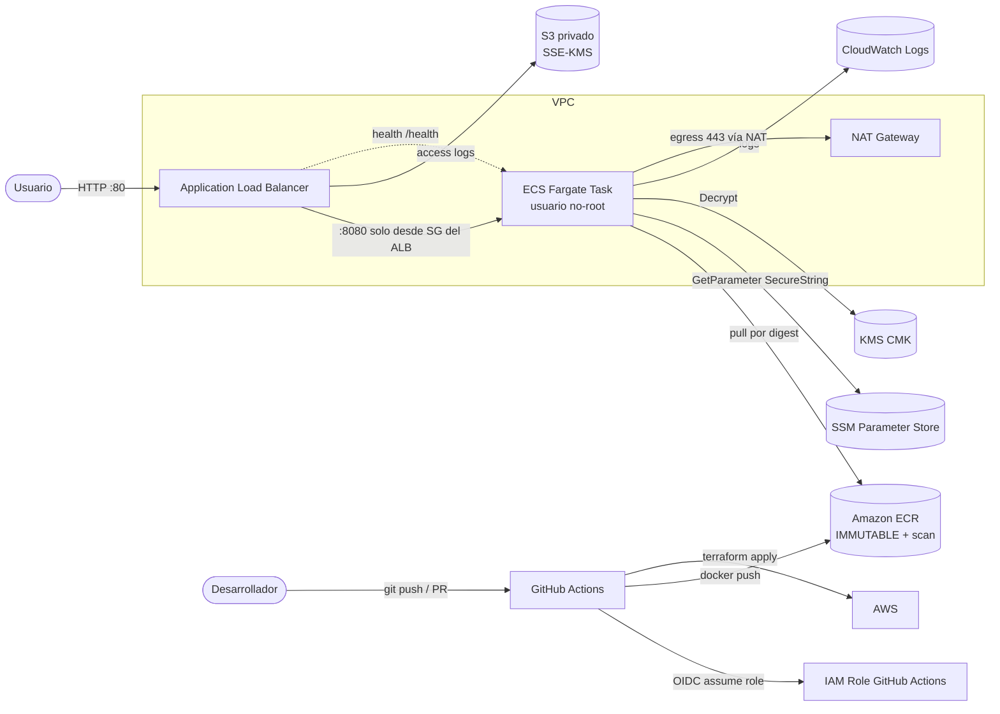
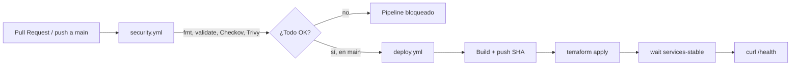

# Corrección de una infraestructura insegura — Checkov y Trivy (AWS)

[](https://github.com/JOJA-TECH/aws-security-remediation-checkov-trivy/actions/workflows/security.yml)

Ejercicio de DevSecOps sobre AWS: se parte de una infraestructura **funcional
pero insegura**, se detectan sus vulnerabilidades con **Checkov** y **Trivy**,
se documentan los hallazgos, se corrigen (≥ 4, aquí 8+) y se despliega la
versión corregida con un pipeline de **GitHub Actions** autenticado en AWS por
**OIDC** (sin claves estáticas).

## 1. Descripción

El repositorio contiene dos versiones de la misma arquitectura:

- `terraform/insecure/` — versión con problemas intencionales (**uso académico**).
- `terraform/secure/` — versión corregida, la que se despliega.

La aplicación es un servidor HTTP mínimo (librería estándar de Python) que
expone `/`, `/health` y `/version`.

## 2. Objetivo

1. Detectar configuraciones inseguras en IaC y en la imagen de contenedor.
2. Documentar los hallazgos y su relación con los problemas introducidos.
3. Corregir al menos cuatro (se corrigen ocho) y verificar con los escáneres.
4. Desplegar la versión segura en AWS mediante un pipeline con compuertas de
   seguridad y autenticación OIDC.

## 3. Arquitectura AWS

- **Amazon VPC** con subredes públicas (ALB + NAT) y privadas (tareas ECS).
- **Application Load Balancer** público en HTTP (ver excepción TLS en §16).
- **Amazon ECS con Fargate** (0.25 vCPU / 512 MiB) ejecutando el contenedor en
  subredes privadas, sin IP pública.
- **Amazon ECR** con etiquetas inmutables, escaneo en push y cifrado KMS.
- **AWS KMS** (clave administrada por el cliente) para ECR, Logs, SSM y S3.
- **AWS SSM Parameter Store** (`SecureString`) para los secretos de la app.
- **Amazon S3** privado para los access logs del ALB.
- **CloudWatch Logs** con retención ≥ 365 días + **VPC Flow Logs**.
- **IAM** con permisos mínimos.

## 4. Diagrama de arquitectura



Flujo de CI/CD:



## 5. Requisitos previos

- Cuenta de AWS con permisos para crear los recursos (o usar `bootstrap/`).
- Terraform ≥ 1.5, AWS CLI v2, Docker, Git.
- Checkov y Trivy (para escaneos locales).
- Un repositorio en GitHub con Actions habilitado.

## 6. Instalación de herramientas

```bash
# Terraform
# https://developer.hashicorp.com/terraform/install

# AWS CLI v2
# https://docs.aws.amazon.com/cli/latest/userguide/getting-started-install.html

# Checkov (Python)
pip install --user checkov

# Trivy
curl -sfL https://raw.githubusercontent.com/aquasecurity/trivy/main/contrib/install.sh | sh -s -- -b /usr/local/bin

# Verificación
terraform version && aws --version && docker --version && checkov --version && trivy --version
```

## 7. Configuración de AWS

```bash
# Perfil de AWS (solo para ejecutar el bootstrap una vez)
aws configure --profile remediation
export AWS_PROFILE=remediation
export AWS_REGION=us-east-1
aws sts get-caller-identity
```

## 8. Configuración de GitHub OIDC

El bootstrap crea el proveedor OIDC de GitHub y el rol que asumirá el pipeline.

```bash
cd bootstrap
terraform init
terraform apply
# Salidas relevantes:
#   github_actions_role_arn
#   tfstate_bucket
#   tflock_table
cd ..
```

Configura en el repositorio (Settings → Secrets and variables → Actions):

| Tipo | Nombre | Valor |
|------|--------|-------|
| Secret | `AWS_ROLE_ARN` | salida `github_actions_role_arn` |
| Variable | `AWS_REGION` | `us-east-1` |
| Variable | `TF_STATE_BUCKET` | salida `tfstate_bucket` |
| Variable | `TF_LOCK_TABLE` | salida `tflock_table` |

La política IAM mínima del rol (creada en `bootstrap/iam.tf`) está acotada por
servicio y, cuando la API lo permite, por ARN. `iam:PassRole` se restringe a
`ecs-tasks.amazonaws.com` y a roles `secure-demo-*`. La relación de confianza
solo admite los `sub` configurados (`refs/heads/main` y el entorno
`production`). No se usan claves de acceso de AWS.

> Si necesitas un **entorno** con aprobación manual, crea en GitHub el entorno
> `production` y añade revisores obligatorios; el workflow `deploy.yml` ya lo usa.

## 9. Variables requeridas

Definidas en `terraform/secure/variables.tf` (todas con valor por defecto salvo
`image_uri`, que es **obligatoria** e inmutable):

| Variable | Descripción | Default |
|----------|-------------|---------|
| `region` | Región AWS | `us-east-1` |
| `project` | Prefijo de recursos | `secure-demo` |
| `environment` | Ambiente | `dev` |
| `team`, `owner` | Tags Equipo/Responsable | `devsecops`, `arquitectura-uc` |
| `image_uri` | URI inmutable (SHA/digest) | **(requerida)** |
| `task_cpu`, `task_memory` | Tamaño Fargate | `256`, `512` |
| `desired_count` | Tareas | `1` |
| `log_retention_days` | Retención de logs | `365` |
| `allowed_http_cidrs` | CIDRs del ALB | `["0.0.0.0/0"]` |

Tags obligatorios aplicados: **Equipo, Proyecto, Ambiente, Responsable**.

## 10. Ejecución local

```bash
docker compose up --build
curl http://localhost:8080/
curl http://localhost:8080/health
curl http://localhost:8080/version
docker compose down
```

## 11. Construcción de la imagen

```bash
docker build --build-arg APP_VERSION=local --build-arg GIT_COMMIT=$(git rev-parse --short HEAD) \
  -t secure-demo:local ./app
docker run --rm -p 8080:8080 secure-demo:local
```

## 12. Ejecución de Checkov

```bash
# Insegura: muestra todos los hallazgos
checkov -d terraform/insecure --framework terraform

# Corregida: debe quedar en 0 (usa los skips justificados de .checkov.yaml)
checkov -d terraform/secure --framework terraform --config-file .checkov.yaml
```

## 13. Ejecución de Trivy

```bash
# Misconfiguración de IaC
trivy config terraform/insecure
trivy config terraform/secure --ignorefile .trivyignore

# Secretos y misconfiguración en el repositorio
trivy fs --scanners secret,misconfig terraform/insecure
trivy fs .

# Imagen
docker build -f app/Dockerfile.insecure -t insecure-demo:local ./app
trivy image --severity CRITICAL,HIGH insecure-demo:local

docker build -t secure-demo:local ./app
trivy image --severity CRITICAL,HIGH --ignore-unfixed secure-demo:local
```

Atajo: `scripts/scan.sh` ejecuta todo y guarda los resultados en `reports/`.

## 14. Despliegue inseguro controlado

El despliegue inseguro es **solo con fines demostrativos** y bajo tu
responsabilidad. Se recomienda:

```bash
cd terraform/insecure
terraform init
terraform plan
terraform apply      # crea recursos deliberadamente inseguros
# ... capturar evidencias ...
terraform destroy
```

> La app insegura se despliega con `:latest` y una task definition sin secretos
> gestionados; solo para mostrar los hallazgos. **No** la dejes en ejecución.

## 15. Identificación de hallazgos

Ver `docs/hallazgos-iniciales.md`. Resumen: **42** controles de Checkov,
**23** misconfiguraciones de Trivy config y **2** secretos detectados por Trivy
en `terraform/insecure/`.

## 16. Correcciones aplicadas

Ver `docs/correcciones.md` (8 correcciones C1–C8 + excepciones). Resumen:

1. Grupos de seguridad mínimos; app solo accesible desde el ALB.
2. Sin puertos administrativos abiertos (acceso vía SSM/ECS Exec).
3. Contenedor no-root, `readonlyRootFilesystem`, sin privilegios.
4. Imagen por SHA/digest inmutable (validado en Terraform).
5. ECR inmutable, con scan-on-push y KMS.
6. IAM de mínimo privilegio (rol de tarea sin permisos).
7. Secretos en SSM `SecureString` (generados con `random_password`).
8. Pipeline que bloquea ante vulnerabilidades críticas/altas.

## 17. Despliegue seguro

Manual:

```bash
export AWS_REGION=us-east-1
export PROJECT=secure-demo
export TF_STATE_BUCKET=<salida bootstrap>
export TF_LOCK_TABLE=<salida bootstrap>
scripts/deploy.sh dev
```

O automático: haz merge a `main`. El workflow `Security` debe pasar; luego
`Deploy` construye, publica por digest, aplica Terraform, espera a ECS y prueba
`/health`.

## 18. Verificación del endpoint

```bash
scripts/verify.sh "$(cd terraform/secure && terraform output -raw health_url)"
curl "$(cd terraform/secure && terraform output -raw app_url)"
```

Respuesta esperada de `/health`:

```json
{"app":"insecure-infra-demo","message":"ok","version":"<sha>","commit":"<sha>","status":"healthy"}
```

## 19. Política de bloqueo del pipeline

`security.yml` falla (y por tanto `deploy.yml` no se ejecuta) cuando:

- `terraform fmt -check` o `terraform validate` fallan.
- **Checkov** reporta **cualquier** control fallido en `terraform/secure`
  (las excepciones deben ser skips específicos y justificados en
  `.checkov.yaml`; nunca `soft-fail` global).
- **Trivy image** detecta `CRITICAL`/`HIGH` **con fix** (política
  `--ignore-unfixed`, justificada en `docs/correcciones.md`).
- **Trivy fs** detecta secretos o misconfiguraciones `CRITICAL`/`HIGH` en las
  rutas seguras.

## 20. Evidencias que deben capturarse

Ver `docs/evidencias.md` (15 puntos con comandos exactos y qué resultado se
espera). Destacan: Checkov/Trivy insecure y secure, comparación de configs,
pipeline bloqueado y exitoso, imagen inmutable en ECR, ECS en ejecución, prueba
de `/health`, `plan/apply/destroy`.

## 21. Destruir la infraestructura

```bash
# Aplicación
cd terraform/secure
terraform destroy -var "image_uri=<digest usado>"

# Backend/OIDC (opcional)
cd ../../bootstrap
terraform destroy
```

Desde CI, el workflow `Deploy` **no** destruye nada por seguridad. Se puede
añadir un `workflow_dispatch` con destrucción manual si se desea.

## 22. Limitaciones y mejoras

- **TLS:** no hay listener HTTPS (requiere dominio + certificado ACM). Excepción
  declarada; en producción añadir listener 443 y redirección.
- **WAF:** no desplegado por costo; compensado con lista de IP permitidas.
- **Backend de estado:** incluye S3 + DynamoDB; los valores llegan por
  `-backend-config` (no versionar credenciales).
- **NAT Gateway único:** un solo AZ para abaratar; en producción, uno por AZ.
- **Estado con secretos:** los `SecureString` generados quedan en el state;
  usar backend cifrado y control de acceso (ya provisto).
- **Imagen base:** fijada por tag `python:3.12.6-slim-bookworm`; considerar
  digest para reproducibilidad total.
- **Firma de imágenes:** añadir Cosign/Notation y SBOM (Trivy `--format cyclonedx`).

## 23. Advertencias de costos y seguridad

**Costos aproximados (us-east-1, pueden variar):**

| Recurso | Costo aproximado |
|---------|------------------|
| NAT Gateway | ~US$0.045/hora + datos (~US$32/mes) |
| EIP asociada al NAT | ~US$0.005/hora |
| Application Load Balancer | ~US$0.0225/hora (~US$16/mes) + LCU |
| Fargate 0.25 vCPU / 512 MiB | ~US$0.012/hora (~US$9/mes) 24×7 |
| KMS CMK | ~US$1/mes por clave |
| CloudWatch Logs | ~US$0.50/GB ingesta + almacenamiento |

> **Destruye los recursos al terminar** (`terraform destroy`) para evitar cargos
> continuos. El NAT y el ALB son los que más cuestan si se dejan encendidos.

**Seguridad:**

- Las credenciales del ejercicio son **ficticias**; no hay secretos reales.
- La carpeta `terraform/insecure/` es peligrosa por diseño; no desplegarla en
  cuentas productivas.
- El pipeline usa OIDC; nunca añadas claves de AWS como secretos de GitHub.

---

## Estructura del repositorio

```text
.
├── app/
│   ├── src/main.py            # servidor HTTP mínimo (/ , /health, /version)
│   ├── Dockerfile             # imagen segura (no-root, base fijada)
│   ├── Dockerfile.insecure    # imagen insegura (académica)
│   ├── requirements.txt
│   └── .dockerignore
├── terraform/
│   ├── insecure/              # infraestructura insegura (académica)
│   └── secure/                # infraestructura corregida
├── bootstrap/                 # OIDC + rol de GitHub Actions + backend de estado
├── .github/workflows/
│   ├── security.yml           # fmt, validate, Checkov, Trivy
│   └── deploy.yml             # build, push, terraform, ECS, /health
├── scripts/
│   ├── scan.sh
│   ├── deploy.sh
│   └── verify.sh
├── docs/
│   ├── hallazgos-iniciales.md
│   ├── correcciones.md
│   └── evidencias.md
├── .checkov.yaml
├── .trivyignore
├── docker-compose.yml
├── .gitignore
└── README.md
```

## Comandos rápidos

```bash
# Local
docker compose up --build

# Escaneos
scripts/scan.sh

# Bootstrap (una vez)
cd bootstrap && terraform init && terraform apply

# Validación Terraform
(cd terraform/secure && terraform init -backend=false && terraform validate)

# Despliegue seguro
scripts/deploy.sh dev

# Destrucción
(cd terraform/secure && terraform destroy -var "image_uri=<digest>")
```
